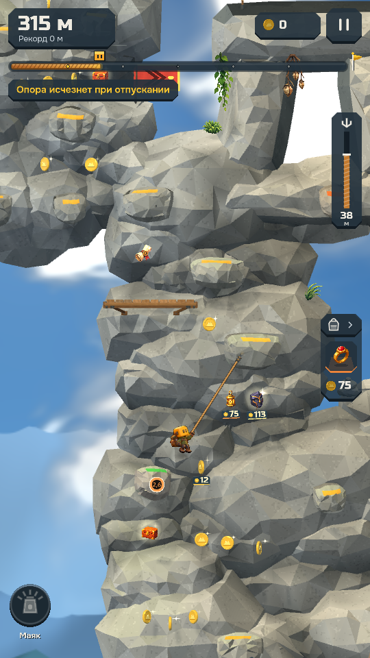
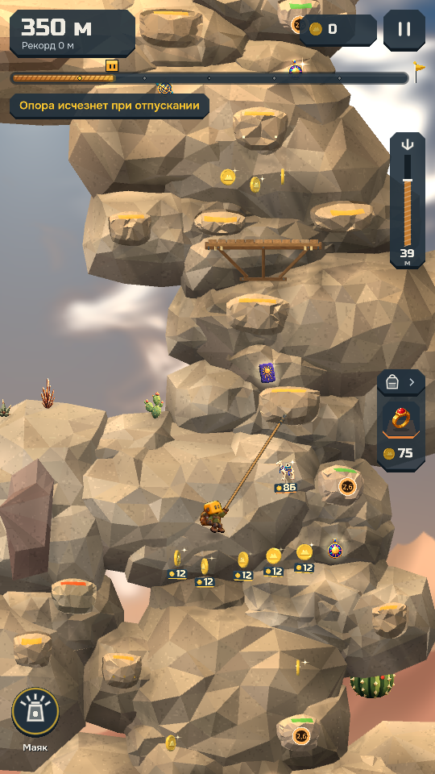
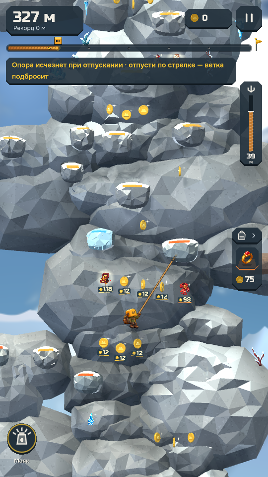
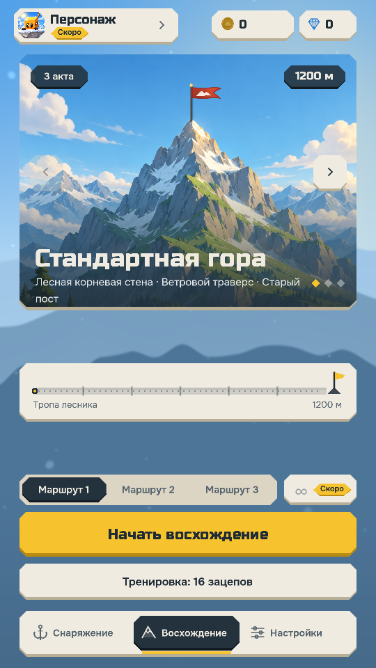
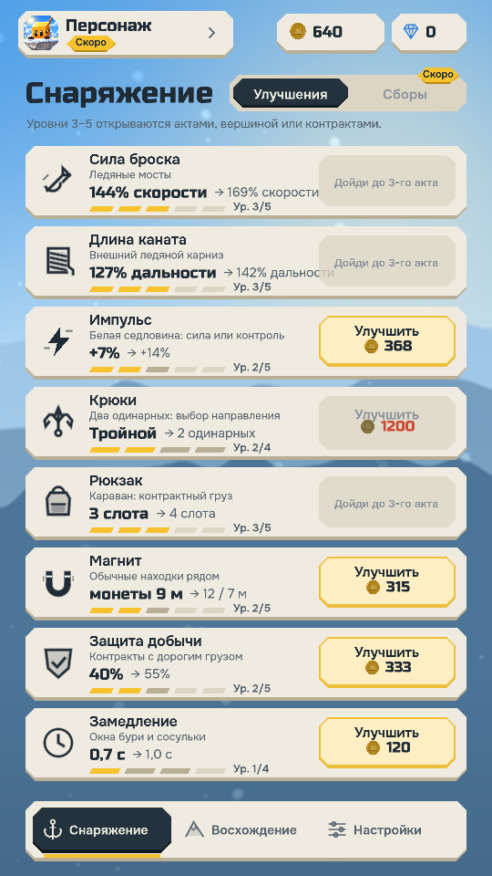
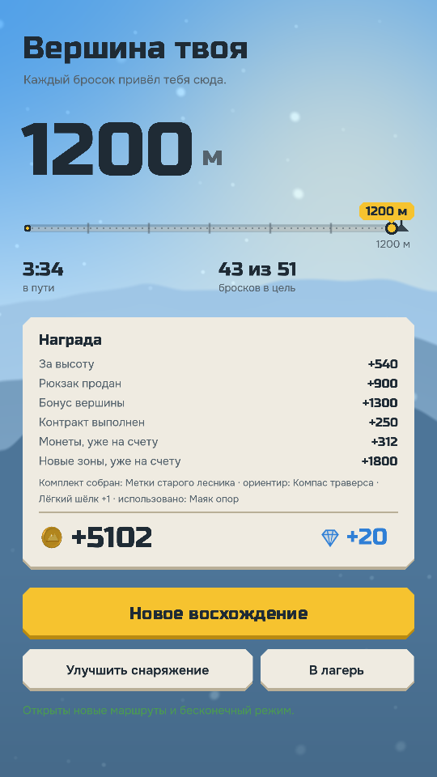

<div align="center">

# Last Hook

**Восхождение на одном крюке.** Бросай крюк, раскачивайся на канате, отпускай в нужный момент и лети к следующей опоре — до самой вершины.

Android · Windows · Godot 4.7 · версия **0.15.6**

[Скачать](https://github.com/DrShapaya/last-hook/releases) · [Как устроена игра](docs/DESIGN.md) · [Создание уровней](docs/LEVEL_PIPELINE.md) · [Что нового](docs/releases/v0.15.6.md)

  

</div>

## Об игре

Вся гора — это цепочка отдельных опор. Большинство из них исчезает, как только ты отцепишься, поэтому каждый перелёт — решение: куда бросить, когда отпустить, рискнуть ли за сокровищем в стороне. Сорвался ниже края экрана — попытка окончена, но снаряжение и золото остаются.

- **Три горы — три экспедиции**: Стандартная гора, Пустынный каньон, Снежная вершина. В каждой три акта со своим правилом и по три заранее проработанных маршрута.
- **Пять типов опор**: обычный камень, корень, который ломается через 2,6 с, пружинящая ветка, скользкий лёд и кристалл-развилка.
- **Опасности актов**: ветровые карманы, кактусы, скорпионы, песчаные бури, осыпающиеся мосты, сосульки и метель.
- **Добыча и прокачка**: сокровища в рюкзак, монеты, материалы и наборы реликвий. Восемь шкал снаряжения, специализации, расходные предметы, контракты.
- **Управление одним пальцем** и плавное замедление на время прицеливания.

<div align="center">
  
</div>

## Играть

Готовые сборки — в [Releases](https://github.com/DrShapaya/last-hook/releases):

- **Android** — `LastHook-…-Android-arm64.apk` (ARM64 и ARMv7).
- **Windows** — архив `LastHook-…-Windows-x64.zip`, внутри `LastHook.exe`.

### Управление

| Телефон | Windows | Действие |
|---|---|---|
| Коснуться, потянуть и отпустить | Зажать ЛКМ, прицелиться, отпустить | Бросить крюк |
| Вести влево-вправо на канате | A / D | Раскачиваться; на площадке — идти |
| Держать вверх или вниз | W / S, колесо | Укоротить или удлинить канат |
| Поднять палец | Пробел | Отцепиться |
| — | Удержать ячейку рюкзака | Выбросить предмет |

## Разработка

### Запуск из исходников

Открыть `game/project.godot` в Godot **4.7.2** и запустить проект (F5). Для Windows есть ярлыки в корне:

| Файл | Что делает |
|---|---|
| `Play.cmd` | Запускает собранную игру, если есть `Builds/Windows/LastHook.exe`, иначе — из исходников. Сохранения — в `UserData/` |
| `OpenEditor.cmd` | Открывает проект в редакторе |
| `PreviewAnimations.cmd` | Просмотр анимаций героя |
| `EditCharacter.cmd` | Старая составная модель героя ([инструкция](docs/CHARACTER_EDITING.md)) |
| `Release.cmd` | Подписанный релизный APK в `Builds/Android/` |

Для сборки положить портативный Godot 4.7.2 с консольной версией и шаблонами экспорта в `tools/godot/`. Для Android дополнительно нужны Java 21 и Android SDK. Движок, SDK, ключи подписи и сборки в репозиторий не входят.

### Сборка и проверки

```powershell
./tools/build.ps1 -Target All
```

Скрипт запекает уровни, прогоняет 21 набор headless-тестов (`game/tests/test_*.gd`), собирает EXE и APK и проверяет подпись. Параметры: `-Target Windows|Android`, `-Release`, `-SkipTests`, пути к SDK и ключу. Журналы и тестовые сохранения пишутся в `artifacts/`.

Один набор тестов вручную (`LASTHOOK_SAVE_DIR` — любая временная папка):

```powershell
$env:LASTHOOK_SAVE_DIR = "$PWD\artifacts\test-save"
tools/godot/Godot_v4.7.2-stable_win64_console.exe --headless --path game --script res://tests/test_hook.gd
```

### Уровни

Конечные уровни лежат готовыми в `game/levels/`: раскладка маршрута (`layout.res`) и статичная геометрия каждого участка для трёх пресетов графики. Их пишет `game/tools/bake_levels.gd`:

```powershell
tools/godot/Godot_v4.7.2-stable_win64_console.exe --headless --path game --script res://tools/bake_levels.gd
```

Рядом с каждым уровнем в `source/` лежит его исходник для редактора уровней: бриф `level.json` и маски (силуэт, коридор маршрута, площадки, зоны опасностей…). Нынешние маршруты выгружены в маски инструментом `game/tools/export_level_masks.gd`. Маски открываются, рисуются и пересобираются во вкладке **«Уровни»** редактора Godot (плагин `game/addons/level_editor`).

Уже запечённая раскладка сохраняется, а геометрия всегда пересобирается из неё. Раскладки, поправленные вручную, помечаются `edited = true`. Аргументы: `-- --only=0:1` — один уровень, `-- --regenerate` — переписать раскладки из генератора. Как будут создаваться следующие уровни — в [LEVEL_PIPELINE.md](docs/LEVEL_PIPELINE.md).

### Структура

```
game/
  scripts/      код игры (GDScript)
  scenes/       сцены: main.tscn, герой
  shaders/      шейдеры камня, неба, эффектов
  data/         balance.json — все числа баланса
  levels/       запечённые уровни (генерируются инструментом)
  assets/       модели, спрайты, шрифты, музыка
  tests/        headless-тесты
  tools/        инструменты движка: запекание, бенчмарки, превью
tools/          сборка (build.ps1), подготовка рекламы, утилиты спрайтов
references/     исходные листы спрайтов для tools/slice_sprites.py
docs/           документация и заметки к релизам
```

Ключевые скрипты:

| Скрипт | Роль |
|---|---|
| `main.gd` | Состояния игры, забег, физика героя и крюка, камера, подготовка мира следующего забега |
| `mountain_world.gd` | Мир уровня: объекты, коллизии, потоковая постройка участков, загрузка запечённых уровней |
| `expedition_layout.gd` | Генератор маршрута: акты, ряды опор, развилки, опасности, лут |
| `massif_visuals.gd` | Скальные массы, декор и ориентиры участка |
| `level_bake.gd` | Формат запечённого уровня |
| `game_hud.gd`, `lobby_view.gd` | Интерфейс забега и лобби |
| `game_model.gd` | Профиль, экономика, прокачка, сохранения |

Производительность меряется инструментами `game/tools/perf_bench.gd` (кадр забега, броски, подгрузка участков) и `perf_start.gd` (вход в уровень).

## Монетизация и данные

Android-сборка использует Yandex Mobile Ads (возрождение за просмотр, межстраничная реклама, баннер в меню) и AppMetrica. Подробности — в [docs/ADS.md](docs/ADS.md). [Политика конфиденциальности](docs/PRIVACY_POLICY_RU.md). Платежей нет.

## Статус

Игра в активной разработке. Баланс проверен ботом, который проходит все маршруты базовым снаряжением. Сложность для живых игроков и работа на реальных Android-устройствах ещё проверяются.
