# Last Hook

Игра для Android и Windows на Godot 4.7.2. Цепляйся крюком, раскачивайся и перелетай между опорами. Большинство опор исчезает после отцепления; проигрыш наступает, когда герой полностью падает ниже экрана.

Текущая версия: **0.15.3**. Отдельных заметок к релизу 0.15 нет — изменения ниже и в отчётах [чата 3](docs/CHAT_3_REPORT.md) и [чата 4](docs/CHAT_4_REPORT.md); прошлый релиз — [0.14.0](docs/releases/v0.14.0.md). Аудит и план исправлений — [AUDIT_LAST_HOOK.md](AUDIT_LAST_HOOK.md).

Логическое описание переработано 10 октября 2026 года: [дизайн игры](01_mechanics_and_gameplay.md), [аудит недостатков](04_design_review.md), [план доведения основы](03_plan_and_production.md). Исправления первого этапа реализованы в 0.11.0; последующие предложения отмечены отдельно. Полная карта документов — [00_README.md](00_README.md).

## Играть

Готовые сборки — в разделе [Releases](https://github.com/DrShapaya/last-hook/releases): Windows-архив и APK для Android ARM64/ARMv7.

- Windows: распаковать архив и запустить `LastHook.exe`.
- Android: установить `LastHook-release.apk` на устройство ARM64 или ARMv7. На мобильном рендере процедурный объёмный фон отключён в пользу штатного градиентного неба, чтобы не компилировать тяжёлый шейдер на несовместимых GPU.
- Из исходников: открыть `game/project.godot` в Godot 4.7.2 и нажать F6/F5.
- Локально в подготовленном проекте: `Play.cmd`.

Сохранения готового EXE хранятся в пользовательской папке Godot. `Play.cmd` использует локальную папку `UserData/`. Сохранения и резервные копии в Git не попадают.

## Управление

| Windows | Действие |
|---|---|
| Зажать ЛКМ, прицелиться, отпустить | Бросить крюк |
| A / D | Раскачиваться; на площадке — идти |
| W / S или колесо | Сокращать / удлинять канат |
| Пробел | Отцепиться |
| Удержать ячейку рюкзака | Выбросить предмет |

На телефоне палец работает как стик от места касания: потяни в нужном направлении и отпусти для броска. На канате веди влево/вправо для раскачки; держи строго вверх/вниз 0,28 секунды для изменения длины. Подними палец, чтобы отцепиться; следующий бросок — новое касание. Дополнительные пальцы не меняют управление. Полный разбор — [docs/ONE_FINGER_CONTROLS.md](docs/ONE_FINGER_CONTROLS.md).

На площадке без каната держи стик строго влево или вправо 0,28 секунды — герой пойдёт; у края он останавливается, спрыгнуть шагом нельзя. Жест, в котором герой шёл, при отпускании крюк не бросает.

## Что изменилось в 0.15 · 22 октября 2026

- Три экспедиции по три акта (генератор v14/v15): у каждого акта свой профиль скалы, правило, опасность (ветер, буря, кактус, скорпион, сосулька, осыпающаяся перемычка), развилка и ориентир. Попытки прежних версий продолжаются на своей геометрии.
- Монеты больше не занимают рюкзак и сразу идут в кошелёк; находки разделены на ценности, реликвии, материалы и контракты; комплекты и контракты дают жетоны мастерства.
- Четыре активных предмета: маяк опор, импульсный бустер, плавное падение, страховочная лента. Прокачка с воротами по актам и специализациями; профиль сохранения v6 с переносом старых.
- Исправления по аудиту: лента во время полёта крюка, опасности в замедлении, частота прогноза броска, запись монет, переполнение текста в HUD и лагере.

## Что изменилось в 0.14.0 · 22 октября 2026

- Типы зацепов с понятными правилами: камень — надёжный переход, корень — 2,6 с с циферблатом на каждом корне, ветка подбрасывает по стрелке и гнётся под нагрузкой, лёд скользит вниз по склону, кристалл — развилка с двумя подсвеченными выходами.
- Генератор v13: тип опор выбирается из сценария связки; основной путь проходим базовым снаряжением, особые типы — только на необязательных ветках, по одному новому правилу за раз, затем повтором на второй ветке. Лёд ведёт крюк вдоль камня с ускорением и передаёт скольжение в полёт; у каждой опоры единый контракт состояний `available → attached → acted → consumed`. Ветки хранят направленные выходы, `RouteGraph.audit` проверяет их в состоянии после действия опоры. Проверки — `tests/test_routes.gd` и `tests/test_grip_types.gd`; забеги v6–v12 восстанавливаются на своей геометрии.
- Пять стилей оформления (лес, руины, снег, пустыня, небо); зацепы в каменных гнёздах, полки — выступы скалы, боковые грани массива, новая трава и кристаллы. Подробно — [план зацепов](docs/GRIP_TYPES_AND_ROUTE_DESIGN.md) и [план визуала](docs/VISUAL_UPGRADE_PLAN.md).
- «Каменные шпили» и «Небесный город» строят зацепы общим кодом вместо прямоугольных плашек; попытки прежних версий продолжаются на своей геометрии.

## Читаемость и камера · 21 октября 2026

- Опоры различаются цветом и формой ещё до полосы состояния: известняк светлый и угловатый, песчаник оранжевый с рваным краем, мох зелёный и скруглённый, лёд голубой с сосульками, аметист фиолетовый, постоянный гранит тёмный с креплениями. У каждой — тёмный контур и светлая верхняя кромка внутри её силуэта; физические границы не изменились.
- На хрупком песчанике стоит циферблат с секундами: полный в покое, во время виса убывает по часовой стрелке и краснеет к концу.
- Площадки отдыха светлее, с тёмным краем снизу и светлой кромкой сверху.
- После приземления ниже кадра камера опускается до 22 % высоты экрана. Опасная граница остаётся там, где была бы без этого смещения, и в этот момент видна пунктиром с затемнением; в полёте камера не опускается.
- Индикатор замедления — компактная плашка с золотой рамкой в верхней строке, между табло высоты и паузой; игровое поле не закрывает. Длительность замедления — восьмая шкала профиля (`slowmo_seconds` в `balance.json`). Пока там одно значение 0,7 с, и карточка в мастерской скрыта, пока не появятся уровни.
- Над кнопкой паузы больше не всплывает подпись «Пауза».

## HUD забега: шкалы, рюкзак, находки · 21 октября 2026

- Шкала маршрута под высотой: деления зон, отметка рекорда, голова героя на текущей высоте, флаг вершины. При входе в новую зону деление вспыхивает, плашка высоты пружинит.
- Высота «докручивается» до реального значения. При побитом рекорде подпись меняется на «Новый рекорд!» с одним пульсом плашки.
- Вертикальная шкала каната справа (появляется на канате): сколько каната выпущено, метры, шевроны при подтягивании и спуске, предупреждение у предела. Длина ушла из текстовой подсказки, там осталось только поведение опоры.
- Таймер корня — полоска обратного отсчёта в красной плашке. Подсказки плавно появляются.
- Рюкзак закреплён вертикально слева: ячейка подсвечена цветом редкости и показывает цену; у редких — пробегающий блик и мерцающая звёздочка. При удержании иконка дрожит, сжимается и показывает крест; выброшенная находка выпадает из ячейки.
- Подобранная находка летит дугой с уступа в свою ячейку, затем ячейка подпрыгивает, расходится кольцо, всплывает «+цена», итог лотка досчитывается после приземления. При полном рюкзаке более ценная находка сама заменяет самый дешёвый подходящий предмет.
- Усиления собраны вертикально справа; кнопки показывают короткое имя, заряд, активный таймер или автоматический режим страховочной ленты.
- Новые иконки предметов ([loot_icon.gd](game/scripts/loot_icon.gd)) совпадают с моделями в мире: монета (медленно поворачивается), янтарь, корона, кубок, идол (светятся глаза), небесная звезда, реликвия, кристалл. Раньше кубок и идол показывались в рюкзаке как реликвия и кристалл.

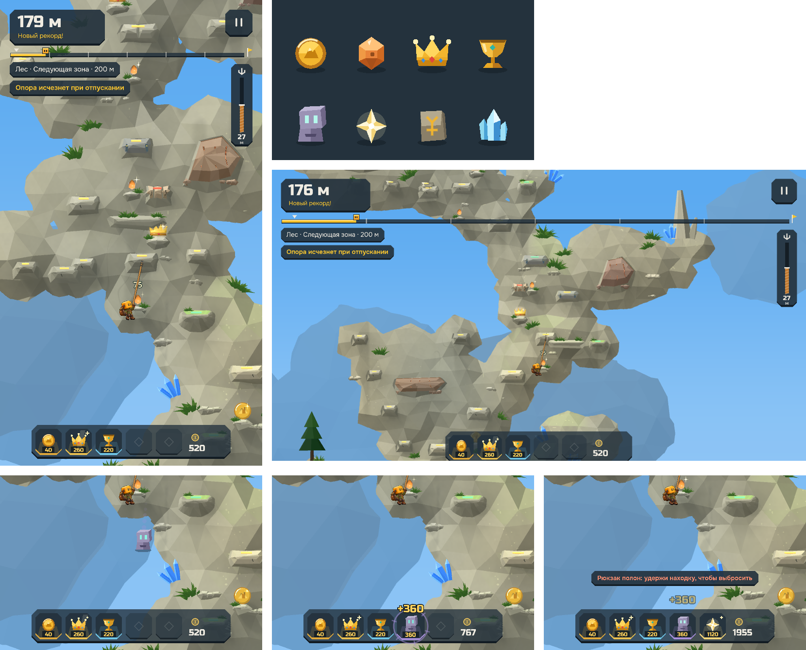

## Новый интерфейс · 21 октября 2026

- Меню перенесены в тот же день, что и восхождение: голубое небо с гранёными хребтами вместо тёмно-синего фона. Панели — известняковые плиты со срезанными углами и тёмной «губой» снизу, как у зацепов. Главная кнопка — жёлтый зацеп, при нажатии проседает в губу.
- Шрифты в комплекте (OFL, [game/assets/fonts](game/assets/fonts)): Russo One — заголовки, цифры, главная кнопка; Onest — текст и остальные кнопки. Убраны капс-надписи, хлебные крошки «LAST HOOK / …» и плитки статистики.
- Сквозной элемент — линия маршрута от 0 до вершины: отметки зон, рекорд, текущая высота, флаг. Есть в лагере, паузе и итогах.
- Лагерь: превью маршрута в палитре игры, номер маршрута, «Закрыто» для неоткрытых. Снаряжение — список строк: значение → следующее, ступени уровня, цена на кнопке. Настройки: сегменты качества и цен, переключатели звука, вибрации и подсказок, шаги управления.
- Пауза и возрождение — полупрозрачное небо поверх забега. Итоги: крупная высота, линия маршрута, награда отдельным блоком.
- HUD забега: тёмные сланцевые плашки высоты и паузы, подсказки — плашками вместо текста с обводкой. Рюкзак и слоумо в том же стиле.
- Исправлено: в альбомной ориентации блок «Управление» больше не заходит под нижнюю навигацию.
- Новая иконка: герой выглядывает из-за уступа и держится за край, канат уходит вверх. Полный набор для Android — фон, передний план в безопасной зоне маски и монохромная версия. Пересборка из исходника: `python tools/make_icon.py`.

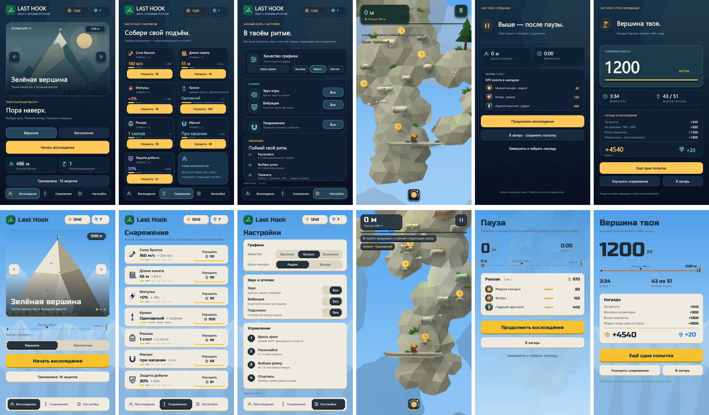
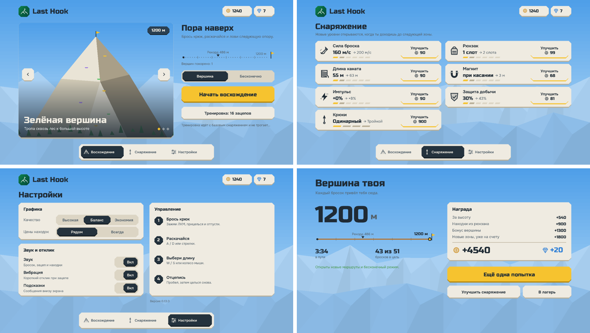
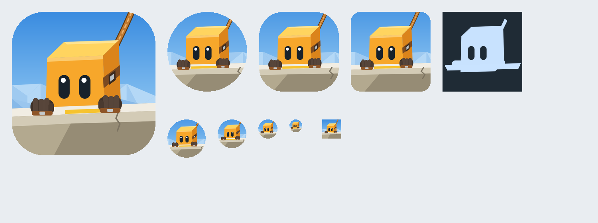

## Валуны вместо стены · 21 октября 2026 (вторая итерация)

- **Макросилуэт.** Ствол маршрута — пары валунов слева и справа от трассы; рядом — боковые острова из 3–5 валунов в 7,5–11,5 м от маршрута (на хребтах и в оврагах один, на прочих формах рельефа два). Между ними открывается небо (19–31% кадра). Валуны выпуклые, многоугольные, 6–10 граней, 3–5 м; коридор маршрута ±2,4 м и камень под каждым зацепом, находкой и препятствием гарантированы. Всё по seed; механика, коллизии и генератор v11 не тронуты.
- **Форма и свет.** Меш строится по решётке плоских фасок ≈1,3 м. Купол каждого валуна задаёт поверхность, соседние лишь приподнимают её, поэтому между валунами образуются складки: верх и левый бок светлые, подбрюшье темнее. Обёрнутое солнце в шейдере камня держит теневые склоны серыми, тени мягкие.
- **Вписание объектов.** Зацепы, препятствия, уступы и полки добычи стоят на «основании» — поясе граней из камня стены и её же шейдера, который спускается от кромки объекта в валун (шире снизу). Мягкая тень впечена в цвет вершин скалы со сдвигом по солнцу; отдельных квадов-теней больше нет.
- **Препятствия** утоплены в валун: низкий профиль, красно-бурый камень, тлеющие трещины, тёплый блик только на верхних гранях, щебень у основания. Сплошной обводки нет.
- **Зацепы** — угловатые глыбы в тоне скалы (6–8 граней, скол на верхней кромке), различаются материалом: колотый известняк (одноразовый), песчаник из трёх кусков с крошкой (хрупкий), скруглённый камень с мхом (упругий), гладкий лёд с сосульками (скользкий), аметист (кристалл), гранит с креплениями (постоянный). Оболочка в пределах игрового полигона, цветные полосы прежние.
- **Крупные элементы** на вершинах боковых островов, по зонам: ели (Лес), каменные шпили с кристаллами (Скалы), обломанные колонны (Руины), ледяные шипы (Лёд), базальтовые столбы с тлеющими вершинами (Вулкан), стела с флажками (Небеса). Не ближе 3 м к маршруту и не над объектами; 2 на участок, на «Батарее» 1.
- **Добыча** стоит на камне: полка для монет и камней, постамент для короны и кубка, уступ для идола и реликвии, рядом пучок травы. Монета крупная, лицом к камере. Ценники по умолчанию — рядом с героем и по линии прицела; в настройках «Цены: рядом / всегда».
- **Материал камня:** крупные тёплые и холодные пятна, вертикальные потёки, редкие пятнышки лишайника, тонкие трещины.
- **Небо** — насыщенный градиент `#5aa9f0` → светлее к низу, без облаков, одинаково дешёвое на ПК и телефоне; позади 1–2 голубых слоя дальних скал с параллаксом.
- **Яркость камня** (4 seed, «Высокое»): p5 = 91–94, p50 = 141–150, p95 = 182–191, средний цвет ≈(146,144,126). Референс: 109/143/193, (147,149,129). Тёмный хвост ниже цели: его дают тени и нижние грани объектов, которые теперь стоят в скале.
- **Постройка участка** (скала, декор, крупные элементы): ≈330 мс до переработки → ≈253 мс сейчас (headless, 4 seed × 4 участка); дальняя полоса ≈20 мс при входе в кадр.

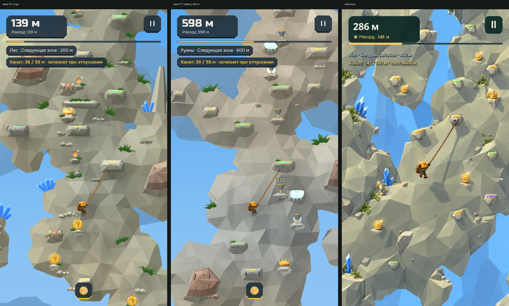

## Визуал под референс · 21 октября 2026

- Скала первой горы: крупные плоские фаски поверх точного контура, каменные блоки-купола с тёмными швами, часть швов открыта в небо — гора распадается на отдельные массивы. Всё детерминировано seed; коллизии и генератор v11 не менялись.
- Единый свет: тёплое солнце сверху слева, холодная заливка неба, одна ортогональная карта теней (без pancake), мягкие контактные тени под зацепами, лутом и декором. Персонаж, канат, крюк, зацепы и предметы отбрасывают согласованные тени.
- Зацепы — каменные выступы с освещённой фаской, трещиной, полосой состояния и корнем в скале; варианты: светлый, тёмный, расколотый, с креплением (постоянный), кристаллический (фиолетовый), хрупкий (красная полоса).
- Предметы ([loot_visuals.gd](game/scripts/loot_visuals.gd)): монета с горной чеканкой, янтарь, корона, кубок, каменный идол, кристалл, реликвия; редкие — ореол и блеск. Данные лута, рюкзак и результаты не менялись.
- Процедурный декор по плоскости фаски: трава, кластеры кристаллов, камешки, корни; не ставится на маршрут, зацепы и находки. Количество зависит от пресета графики (Высокое/Баланс/Батарея).
- HUD забега в лесном зелёном вместо синего. Новый набор проверок `tests/test_visuals.gd` добавлен в `tools/build.ps1`.

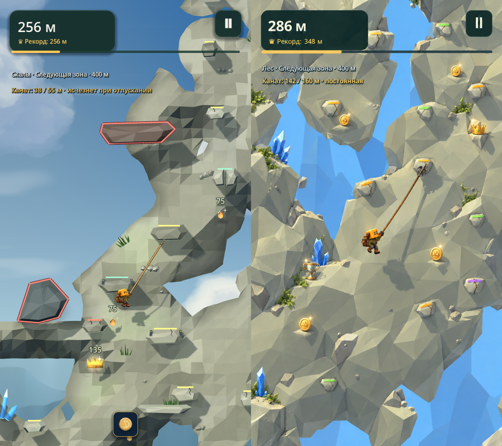

## Прокачка и баланс · 0.13.0

- Сглажены цены: 90 / 450 / 1800 / 5400 / 9000 до множителя шкалы. Последний уровень больше не забирает 77% бюджета. Все 32 покупки стоят 101 956 золота вместо 129 918.
- Крюки получили четыре понятные ступени: **одинарный центральный → тройной → два одинарных с разбросом 8° → два тройных**. Цены переходов: 900 / 1 800 / 3 000 золота.
- Два крюка летят одновременно. Если оба попали в опоры, первая валидная зацепка удерживает героя, а второй крюк возвращается и не создаёт вторую верёвку.
- Профиль v5 сохраняет купленные уровни и текущую попытку; старые профили переводятся на новую схему один раз с возвратом разницы стоимости.
- Магнит выбирает ценную находку среди одновременно доступных, прямое касание имеет приоритет. При полном рюкзаке более дорогая находка автоматически заменяет самый дешёвый подходящий предмет.
- Результат отдельно показывает золото новых зон и учитывает их алмазы; мастерская называет высоту открытия. Исправлен пропущенный четвёртый шаг мобильного управления.
- Пересчитаны 600 условных сценариев развития с сравнением старых цен на тех же seed. Допущения и пределы расчёта: [баланс](docs/BALANCE.md), [отчёт](docs/validation/progression-economy.json). Ручная проверка темпа ещё требуется.

## Динамика броска · 18 октября 2026

- Крюк летит по баллистической дуге, падает под собственным весом и получает часть скорости героя. Направление после броска не меняется; наконечник поворачивается по траектории.
- Прицел показывает эту же дугу и первый контакт с учётом движения героя и столкновений. Сенсорный стик задаёт угол броска от центра касания, независимо от положения пальца на экране, героя и камеры. Мышь сохраняет наведение на точку.
- Канат разматывается волной, при зацепе выбирает небольшой провис и затухает. Скорость раскачки сохраняется; натяжение возникает после выбора провиса.
- При промахе крюк возвращается к герою, при ударе о скалу отскакивает. Следующий бросок сразу прерывает возврат.
- Отдача руки, след крюка, вспышка контакта и отдельные звуки подчёркивают запуск, зацеп и удар. Скорость и стадия полёта сохраняются при выходе из игры.

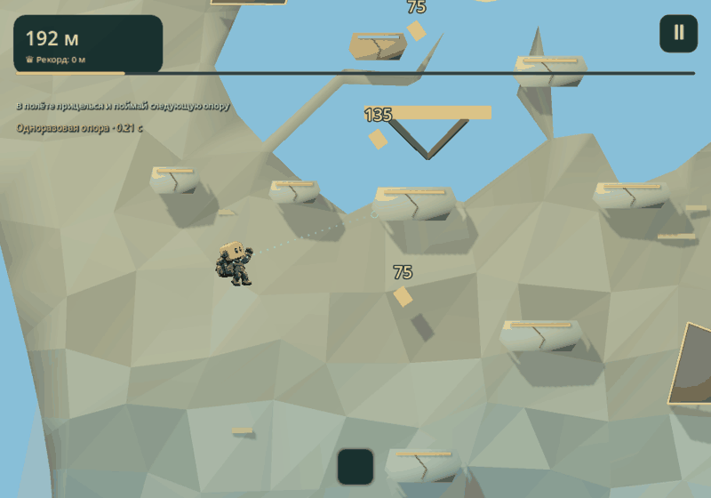

## Полировка управления и камеры · 18 октября 2026

- Плавающий стик задаёт направление от места касания. Камера и движение героя не поворачивают удерживаемый угол; возврат к центру отменяет бросок.
- Нейтральная зона убирает дрожание пальца. Свайпы не отцепляют крюк. Вертикальный мотор включается после удержания 0,28 с в секторе ±15° и работает без новых событий движения.
- Подъём пальца на канате только отцепляет героя. Следующий бросок требует нового касания и выбора направления. После нового зацепа управление начинается с нейтрали.
- Подтягивание плавно разгоняется, тормозит и меняет направление. Дополнительные пальцы игнорируются во время основного жеста; отмена касания и смена ориентации не создают выстрел и не отцепляют героя.
- Камера смотрит вперёд по скорости и прицелу, приглушает мелкое движение в вершине раскачки и следует вбок во всех локациях. Пауза останавливает камеру и время подсказок; горизонтальное положение и скорость подтягивания сохраняются.

Техническая проверка включает разные частоты касаний, масштабы интерфейса, 30/60/120 FPS камеры и реальную цепочку одного пальца. Удобство на физическом телефоне ещё нужно оценить вручную.

## Коллизии и препятствия · 18 октября 2026

- Крюк, канат и тело используют один выпуклый контур каждого препятствия. Радиус крюка учитывается при ударе о край, а нулевой тестовый луч не получает невидимого расширения.
- Отступ наконечника учитывается отдельно от видимого контура препятствия; тонкий луч каната не получает невидимого расширения.
- Наклонные камни проверяются по грани, а не по прямоугольному `dimensions`; скольжение и огибание сохраняют нормаль реальной грани.

## Визуальная полировка горы · 18 октября 2026

- Сетка скалы стала плотнее: фаски и цветовые переходы выглядят мягче, при этом физическая геометрия генератора не меняется.
- Опоры получили отдельный верхний ободок, нижнюю грань и материал по типу; декоративные элементы следуют фактическому контуру.
- Небо, объёмные облака и дальние хребты генерируются шейдером из seed, без фоновых картинок. Облака имеют освещённые кромки, затенённые объёмы, дрейф и медленное изменение формы; тонкие слои и хребты создают параллакс и воздушную перспективу.
- Генерация атмосферы ограничена отдельным viewport до 640 px на ПК / 448 px на телефоне и 24 обновлениями в секунду. Пауза замораживает движение. [Проверены](docs/validation/sky.json) повторяемость seed, ветер, камера и смена пропорций окна; производительность на физическом телефоне ещё не измерена.

## Гора и взаимодействия · генератор v10

- Новые попытки первой горы собираются из восьми ритмов движения: траверсы, развороты, вертикальные подъёмы, широкие перелёты, карманы отдыха и обходы. Соседние связки не повторяются; первые два перехода остаются мягкими.
- Столбы, карнизы и наклонные скалы расставляются возле связок с проверкой основного коридора, выхода боковой находки, свободного подвеса и связности сети. Пустоты горы связаны с характером участка.
- Герой скользит по настоящей грани и приземляется на выступы; крюк и канат используют тот же контур. Канат огибает до четырёх углов, распрямляется и сохраняет изгибы при выходе из игры. Длина учитывает весь путь вокруг скалы.
- Магнит не собирает находки через стену. Приземление на площадку вершины засчитывает победу. Редкие площадки отдыха оставляют место для раскачки со всеми наконечниками.
- Активные попытки v6–v9 продолжаются на прежней геометрии; v10 применяется к новым. Остальные локации сохраняют генератор v4.

## Обновление меню · 17 октября 2026

- Лагерь разделён на «Восхождение», «Снаряжение» и «Настройки». На главном экране — выбор горы, режим, старт/продолжение и тренировка.
- Единый лесной стиль: топографический фон, тёплое золото, крупные заголовки, пиктограммы и плавное появление экранов.
- Мастерская показывает текущий и следующий эффект, уровни, цену и доступность покупки; после покупки остаётся открытой.
- Новые экраны паузы, продолжения, победы, поражения и результатов тренировки. Полный рюкзак показывает все шесть находок и их цены.
- В настройках — сохраняемый переключатель звука и управление для текущей платформы. Вертикальная и горизонтальная компоновки проверяются отдельно.

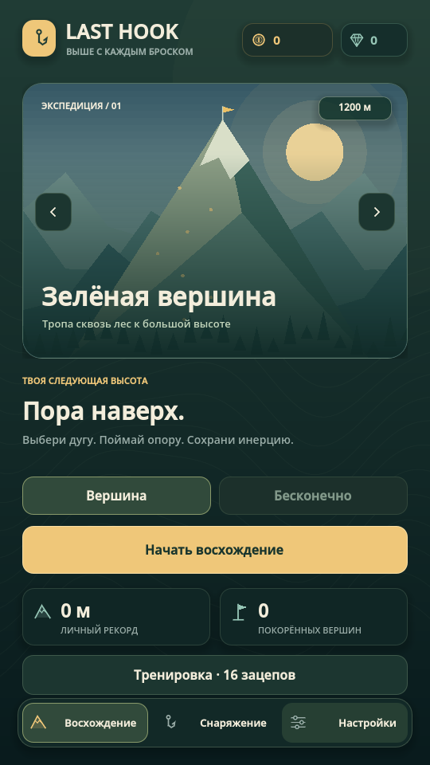

## Что изменилось в 0.11.0

- Любую достигнутую находку можно подобрать в свободный слот. Рюкзак увеличивает вместимость, а не закрывает дорогие типы.
- Каждая повторная вершина даёт 3 алмаза; первая по-прежнему 20. Алмазы можно снова заработать после расхода на продолжения.
- Новые попытки первой горы используют генератор v9: боковая находка имеет выход вперёд; аварийные зацепы включаются после проверенного возрождения. Уничтоженные обычные опоры и находки не возвращаются.
- **Тренировка · 16 зацепов** в лобби: фиксированный маршрут и базовое оснащение, собственный результат. Основной профиль не меняется. Для входа нужно завершить активную обычную попытку.
- Дорогая находка отмечена на значке; содержимое и точные цены можно осмотреть на паузе.
- Прицел предупреждает, если герой успеет удалиться за длину каната до прилёта крюка. Пороги жестов учитывают масштаб интерфейса.
- Сохранённые попытки v6/v7/v8 продолжаются на прежней геометрии. Покупки, кошелёк и профиль версии 5 сохраняются; старые профили мигрируют автоматически.

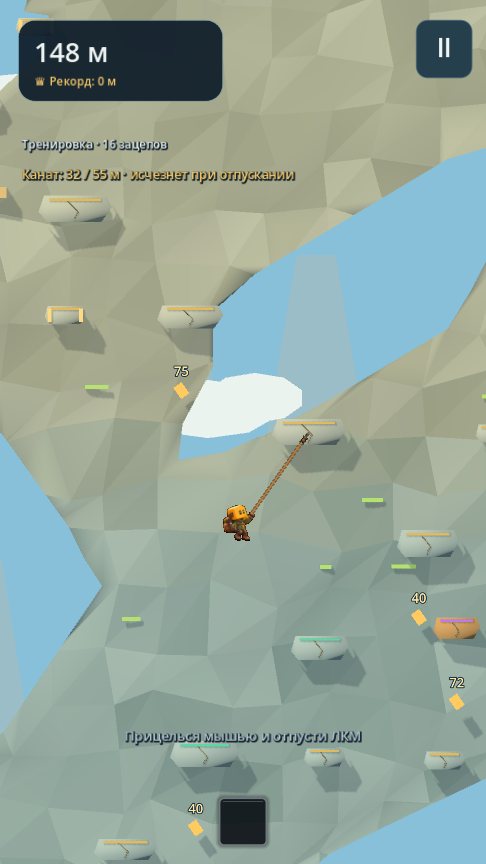

## Что изменилось в 0.10.6

- Новый цельный персонаж из одного PNG: большая голова, компактное тело, непрерывный рисунок одежды и конечностей.
- Шесть состояний: ожидание, бросок крюка, раскачивание, полёт вверх, падение и приземление. Поза, наклон и разворот плавно переходят между состояниями; рюкзак слегка отстаёт от движения тела.
- Непрерывная анимация поверхности сохраняет соединения частей рисунка. Канат следует за изображённой кистью. Пауза останавливает анимацию.
- **PreviewAnimations.cmd** открывает все шесть анимаций одновременно. **PreviewSource.cmd** запускает игру из исходников.

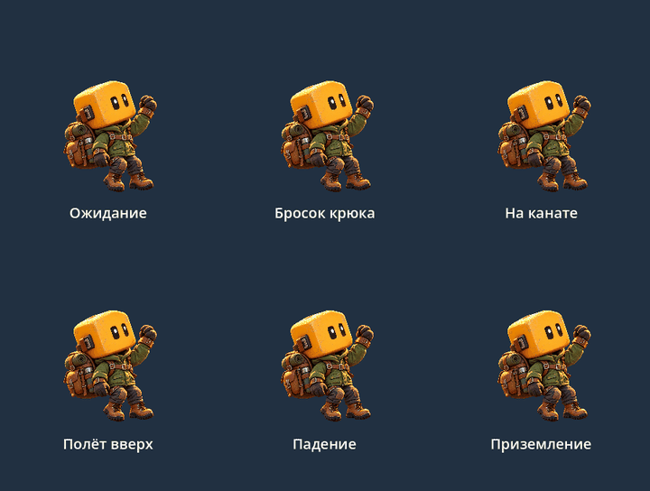

## Что изменилось в 0.10.5

- Исправлен сгиб заднего локтя; детали рукава и перчатка развёрнуты для задней руки.
- Заднее плечо остаётся за торсом. Открытые торцы деталей скрыты в стыках локтей.

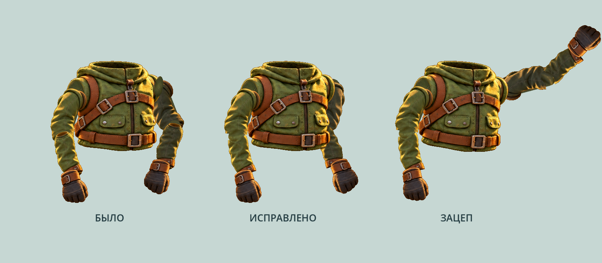

## Что изменилось в 0.10.4

- Исправлены стороны рук для ракурса торса: видимая пройма слева принадлежит ближней руке.
- Плечи совмещены с центрами нарисованных отверстий; ткань плеча закрывает полость проймы при движении.

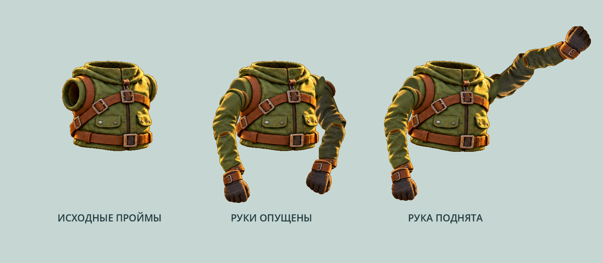

## Что изменилось в 0.10.3

- Плечи и бёдра привязаны к точкам на рисунках куртки и шорт с перекрытием внутри корпуса.
- Верх рукавов и штанин заведён под одежду; скрытая основа закрывает просветы между деталями конечностей.

## Что изменилось в 0.10.2

- Исправлены точки вращения деталей: плечи, локти, кисти и колени соединяются без смещения.
- Корпус и ботинки получили больше объёма, убран чрезмерный наклон; большая голова и компактный силуэт сохранены.

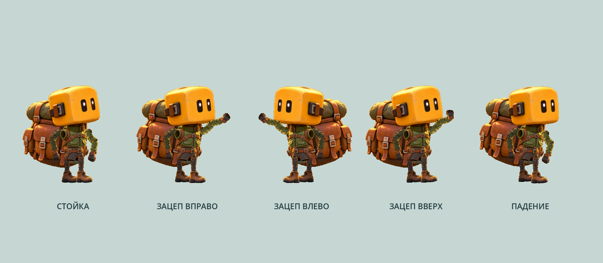

## Что изменилось в 0.10.1

- Компактный персонаж с большой головой, маленьким телом и короткими конечностями, ростом примерно с рюкзак.
- Наконечник крюка вдвое меньше; канат соединён с его кольцом.

## Что изменилось в 0.10

- Игрок собран из рисованных деталей: зелёная куртка, жёлтая голова, кожаный рюкзак, перчатки и ботинки.
- Плечи, локти, бёдра и колени двигаются; персонаж разворачивается, тянется к крюку и моргает.
- Канат стал объёмным и плетёным. Текстура повторяется по длине; провисание сохраняется.
- Новый металлический крюк использует исходный рисунок с латунными креплениями. Визуально совпадают и число наконечников, и число одновременно летящих крюков.
- Канат соединяется с кистью и кольцом крюка. Сохранения, физика и цены не изменены.

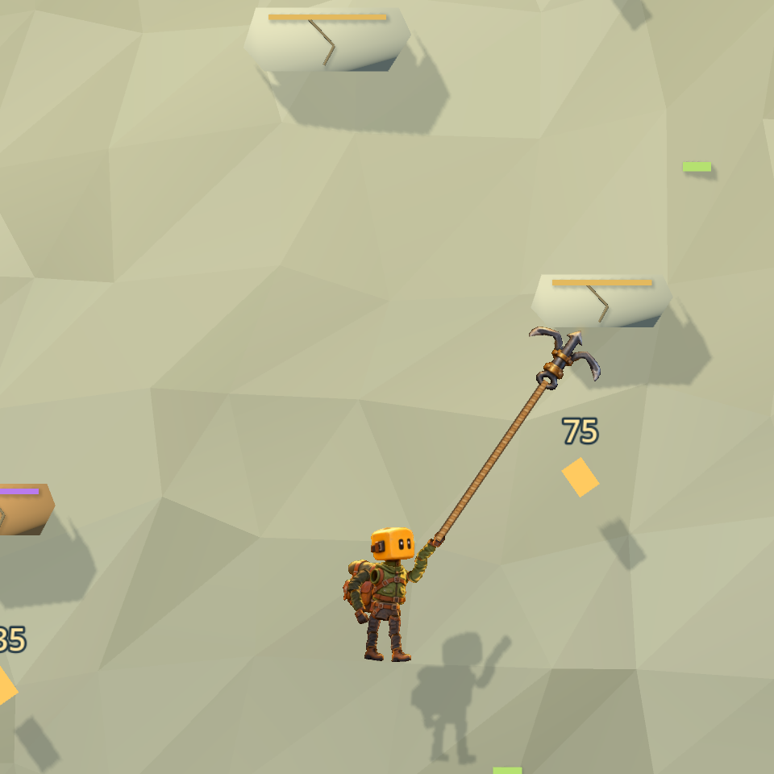

## Что изменилось в 0.9

- Мир и фон заполняют окно без чёрных полос. Интерфейс учитывает пропорции экрана; широкое лобби использует две колонки.
- На конце каната виден металлический крюк и при полёте, и после зацепа.
- Вместо «Захвата» — **одинарный → тройной → два одинарных → два тройных**. Разброс двух линий небольшой, а при двух попаданиях удерживает только первая опора; вторая линия возвращается.
- Лёд и кристалл доступны базовому крюку. Старые покупки «Захвата» переносятся в новую конфигурацию крюков; остальные улучшения и активная попытка сохраняются.
- Сила броска определяет скорость крюка, длина каната — досягаемость. Это отдельные улучшения.

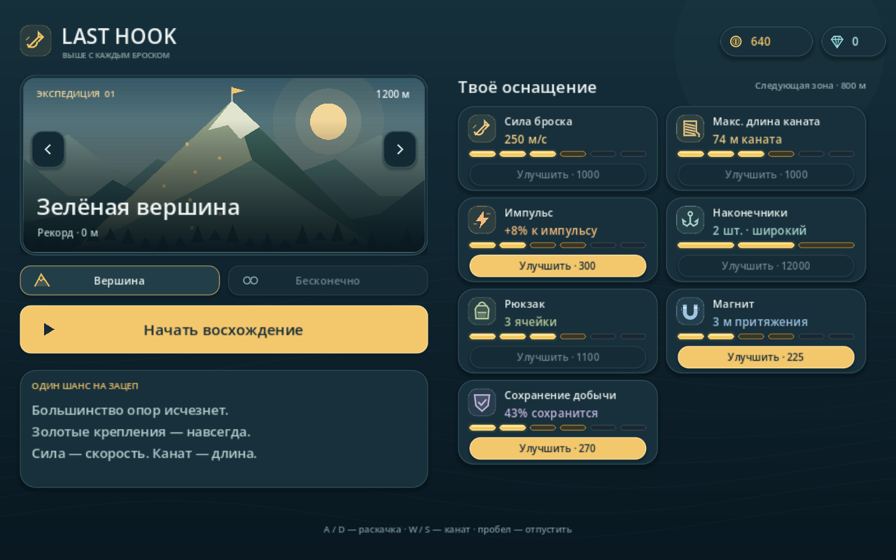

## Собрать персонажа вручную

Старая составная модель сохранена в `game/scenes/player.tscn`; **EditCharacter.cmd** открывает её для редактирования. Текущая игра использует цельный рисунок через `player_sprite.tscn`. Правки старой составной модели не влияют на текущего персонажа.

Пошаговая инструкция и названия деталей: [docs/CHARACTER_EDITING.md](docs/CHARACTER_EDITING.md).

## Разработка и проверки

В `game/` находятся проект, исходники, ресурсы и проверки. Числа баланса — в `game/data/balance.json`. Дизайн и ограничения описаны в [00_README.md](00_README.md) и [07_prototype_status.md](07_prototype_status.md).

Для автоматической сборки поместить портативный Godot 4.7.2 Windows с консольной версией и установленными шаблонами экспорта в `tools/godot/`. Для Android нужны Java 21, Android SDK и отладочный ключ в настройках редактора. Движок, SDK, ключи и результаты сборки не включены в репозиторий.

```powershell
./tools/build.ps1 -Target All -AndroidSdkPath 'C:\Android\Sdk' -JavaSdkPath 'C:\Java\jdk-21'
```

Скрипт запускает проверки правил, интеграции, генерации, адаптивного интерфейса, сохранения старой ручной сборки и плавности анимации цельного спрайта; затем собирает EXE/APK и проверяет подпись APK. Проверки используют отдельные профили в `artifacts/`.

Для запуска проверок вручную задать `LASTHOOK_SAVE_DIR` в отдельную временную папку, импортировать проект в Godot, затем выполнить нужный `game/tests/test_*.gd` через `--headless --script`.

Баланс требует ручных игровых сессий. Проверки ботом не подтверждают сложность и удобство для человека. Физические Android-устройства и вырезы экранов ещё не проверены. Подключены Yandex Mobile Ads и AppMetrica для Android: возрождение за просмотр, межстраничная реклама после прохождения горы, баннер в меню и аналитика сессий. Debug APK использует демоблоки, release — ID владельца. Сборка и проверка описаны в [docs/ADS.md](docs/ADS.md). Платёжного SDK нет.

## Препятствия и уступы · генератор v11 · 19 октября 2026

Препятствия больше не рисуются как одинаковые заглушки. Генератор сохраняет три понятных типа — наклонный клин, вертикальный столб и широкий карниз — и добавляет каждому из них три seed-варианта: силуэт, асимметрия, оттенок и разломы меняются, но физический полигон остаётся источником формы. Обязательный переход, ветка находки, подвес под зацепом и связность графа проверяются до добавления объекта.

Визуал строится из того же выпуклого полигона: передняя плоскость разбита на фаски, по контуру проходит кромка, снизу появляется тень, а форма получает характерную деталь. У карниза есть две каменные подпорки, у столба — вертикальные слои и сколотая вершина, у клина — диагональный излом. Эти элементы декоративны и не создают невидимой коллизии.

Площадки отдыха получили три формы: консольную полку, седловидный уступ и клиновидную площадку. Верхняя грань выделена светлой кромкой, нижняя — тёмной, опоры уходят назад в скалу. Стиль хранится в данных генератора, поэтому повторяется при том же seed и не зависит от порядка загрузки чанков.

[Широкий кадр с формами](docs/screenshots/obstacle-forms-wide.png) и [кадр уступа с канатом](docs/screenshots/obstacle-forms-terrain.png). Детали и результаты проверок — [obstacle-forms.json](docs/validation/obstacle-forms.json).
